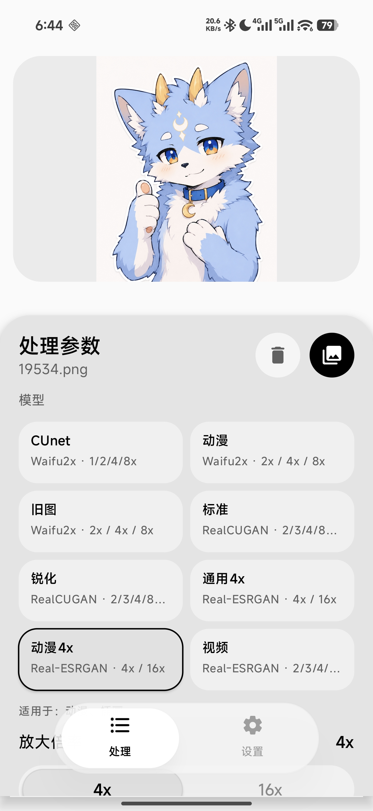

<div align="center">


# LumaSR · 本地 AI 图像超分

**基于 ncnn 与 Vulkan/CPU 的 Android 离线图像超分工具**

[](https://github.com/HF-CYGG/LumaSR/actions/workflows/release-contract.yml)
[](https://github.com/HF-CYGG/LumaSR/releases/latest)
[](LICENSE)


[](https://github.com/HF-CYGG/LumaSR/stargazers)
[](https://github.com/HF-CYGG/LumaSR/commits)

</div>

---

LumaSR 是一款面向 Android 的本地 AI 图像超分工具，基于 ncnn 与 Vulkan/CPU 加速实现离线推理，支持 Waifu2x、RealCUGAN、Real-ESRGAN 等模型，提供极简参数控制、实时分块处理预览与处理后结果预览体验。

项目目标是把常见超分模型做成可直接在手机端运行的轻量工具：不上传图片、不依赖云端服务，并尽量保留清晰、可维护的 Android 与 Native 分层。

## 界面预览



## 功能特性

- 本地离线推理：图片与模型均在设备端处理。
- 内置模型包：随 APK 打包 Waifu2x、RealCUGAN、Real-ESRGAN 系列权重。
- ncnn Native 引擎：通过 JNI 调用 C++ 推理层，支持 `.param/.bin` 模型加载。
- Vulkan/CPU 模式：支持自动模式，GPU 不可用时可回退 CPU。
- 分块处理进度：按 tile 推进并向 Compose UI 回传阶段、百分比与 tile 状态。
- 结果预览：处理完成后直接展示处理后的输出图片。
- 结果保存与分享：PNG 结果可保存到系统相册目录，并在保存后调用系统分享。

## 技术栈

- Kotlin + Jetpack Compose + Material 3
- MVVM + StateFlow + Coroutine
- Android Photo Picker 与 scoped storage
- JNI + CMake + C++17
- ncnn Android Vulkan SDK
- stb_image / stb_image_write

## 项目结构

```text
app/src/main/java/com/lumasr/   Compose UI、ViewModel、data/domain/processor
app/src/main/cpp/               JNI、CMake、ncnn 推理与分块处理
app/src/main/assets/            model_manifest.json 与内置模型文件
app/src/test/                   Manifest、参数映射、处理状态等 JVM 测试
docs/                           Native 推理和模型打包说明
scripts/download-deps.ps1       国内镜像依赖与模型安装脚本
scripts/build-fixed-release.ps1 固定证书签名与规范 Release 资产构建脚本
scripts/publish-github-release.ps1 GitHub Release 发布前校验与显式发布入口
```

## 内置模型

当前 APK 内置模型由 `app/src/main/assets/model_manifest.json` 管理：

| 引擎 | 模型 | 适用场景 |
| --- | --- | --- |
| Waifu2x | CUnet | 插画、动漫线稿、高质量降噪 |
| Waifu2x | Anime | 动漫截图、压缩插画 |
| Waifu2x | Photo | 普通照片柔和增强 |
| RealCUGAN | Standard | 干净插画与通用动漫图 |
| RealCUGAN | Pro | 压缩瑕疵修复与高质量增强 |
| Real-ESRGAN | x4plus | 真实照片与退化图片 4x 修复 |
| Real-ESRGAN | x4plus anime | 动漫、插画 4x 增强 |
| Real-ESRGAN | AnimeVideo v3 x2/x3/x4 | 动画帧和视频截图 2x/3x/4x 增强 |

模型文件来自上游开源项目或其 Android 资产包，仓库仅按清单打包运行所需文件。具体下载、校验和来源约束见 [docs/builtin-models.md](docs/builtin-models.md)。

## 构建环境

- JDK 17
- Android SDK 35
- Android NDK `27.2.12479018` 或更新版本
- CMake 3.22.1
- Gradle 缓存建议使用 `F:\Development\gradle`
- 所有外部下载必须使用国内镜像或代理地址，避免直接访问 `github.com`、`dl.google.com`、`repo.maven.apache.org`、`services.gradle.org`

Native 依赖说明见 [docs/native-inference.md](docs/native-inference.md)。

## 快速开始

```powershell
# 校验内置模型和 native 依赖是否齐全
.\scripts\download-deps.ps1 -ValidateOnly

# 运行 JVM 单元测试
.\gradlew.bat -g F:\Development\gradle testDebugUnitTest

# 构建 Debug APK
.\gradlew.bat -g F:\Development\gradle assembleDebug
```

构建产物位于：

```text
app/build/outputs/apk/debug/app-debug.apk
```

## 验证命令

```powershell
.\gradlew.bat -g F:\Development\gradle testDebugUnitTest
.\gradlew.bat -g F:\Development\gradle lintDebug
.\gradlew.bat -g F:\Development\gradle assembleDebug
```

建议在 Android 10 或更新版本的真机/模拟器上手动验证：选择图片、切换模型与参数、开始处理、取消处理、完成后查看输出图片、保存并分享 PNG 结果、深色模式下控件不遮挡。

## 正式发布

正式版本使用不可变的 `vX.Y.Z` 数字标签和唯一的 `LumaSR.apk` 附件。固定签名构建、SHA-256、标签门禁、GitHub Release 发布及发布后回查步骤见 [docs/release-process.md](docs/release-process.md)。

应用内更新检查直接读取 GitHub 最新正式 Release，不使用自建服务器；国内下载入口会为通过仓库白名单校验的原始 APK 地址添加 `https://gh.jasonzeng.dev/` 前缀。

## 后续计划

- 增加批量队列和历史记录。
- 提供更细的 tile 大小、线程数和显存策略控制。
- 补充不同机型上的 Vulkan 兼容性与性能基准。
- 补充更多真实设备上的覆盖升级与下载链路验证记录。

## 许可与来源

项目代码采用 [LumaSR Noncommercial License](LICENSE)，仅允许非商业目的使用、复制、修改和再分发。

**不得用于任何商业行为。** 未经版权所有者事先书面授权，任何个人、团队、公司或平台均不得将本项目、修改版、构建产物、APK、模型整合包或衍生作品用于售卖、付费下载、付费分发、商业服务、广告变现、订阅收费、内购、商业产品捆绑、平台运营或其他任何营利目的。

分发或转载时必须保留本许可声明和版权声明。历史上已经按 MIT License 获取的旧版本，仍可能受当时许可约束；本次更改适用于本仓库后续发布的代码版本。

ncnn、Waifu2x、RealCUGAN 及模型权重遵循各自上游项目许可；分发或二次打包前请确认对应模型来源、授权和署名要求。
## Model Update: Real-ESRGAN

LumaSR now exposes additional built-in Real-ESRGAN models through `model_manifest.json`:

- `Real-ESRGAN x4plus`: general real-world photo restoration.
- `Real-ESRGAN x4plus anime`: anime and illustration enhancement.
- `Real-ESRGAN AnimeVideo v3 x2/x3/x4`: animation frame enhancement with 2x, 3x, and 4x variants.

The built-in scale list is also corrected for existing RealCUGAN assets:

- `RealCUGAN Standard`: `2x / 3x / 4x`
- `RealCUGAN Pro`: `2x / 3x`

Use `scripts/download-deps.ps1 -RealEsrganModelsZipUrl "<domestic-mirror-zip>"` to install the Real-ESRGAN `.param/.bin` files. `-RealEsrganZipUrl` is still accepted for compatibility. Direct GitHub download URLs remain blocked by the script; use a domestic mirror or proxy URL.
